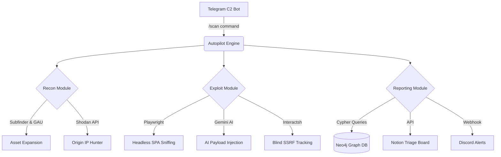

# 🛡️ Aegis-Auto | The Autonomous AI Bug Bounty Platform

<div align="center">
  
  
  
  
  
</div>

<br>

Aegis-Auto is a **commercial-grade, serverless DevSecOps vulnerability scanner** engineered for the modern Bug Bounty Hunter. It leverages AI-driven exploitation, Graph Database asset tracking, Headless SPA crawling, and Telegram C2 for continuous, autonomous vulnerability discovery.

---

## ✨ Enterprise Features

- **🧠 Autonomous AI Hacker:** Utilizes Gemini AI to synthesize context-specific zero-day payloads (RCE/SQLi) dynamically during runtime.
- **📱 Telegram Command & Control (C2):** Fully remote-controllable scanning engine via a secure Telegram Bot interface.
- **🕸️ Headless SPA Fuzzing:** Implements Playwright Chromium engines to render React/Angular apps and intercept hidden `POST/PUT` API state changes.
- **🌐 Graph Database OSINT:** Maps targets (Subdomains → IPs → Open Ports → Vulns) visually via Neo4j Graph queries.
- **📡 Blind OOB Detection:** Integrated Interactsh for asynchronous Blind SSRF and XSS callback hunting.
- **🤖 Self-Learning Engine:** Automatically translates novel AI-discovered vulnerabilities into YAML Nuclei Templates for future scans.
- **🎫 DevSecOps Integrations:** Automated Notion Kanban ticketing and Discord Webhooks for real-time alerting.

---

## 🏗️ System Architecture



---

## 🚀 Quick Start (Dockerized)

Aegis-Auto comes with a stunning **Web Configuration Portal** to safely inject your API keys into the environment without touching any code.

### 1. Clone & Spin up the Docker stack
```bash
git clone https://github.com/yourusername/aegis-auto.git
cd aegis-auto
docker-compose up -d
```

### 2. Access the Configuration Portal
Navigate to `http://localhost:5000` in your web browser. You will be greeted by a modern glassmorphism UI where you can securely input your Telegram, Gemini, Notion, and Shodan API keys. 

Hitting **"Deploy Configuration 🚀"** automatically injects the secrets into the running pipeline containers.

### 3. Trigger your first scan
Message your Telegram Bot from your phone:
```text
/scan hackerone.com
```
Or run the scanner manually:
```bash
docker exec -it aegis-auto-autopilot-1 python autopilot.py
```

### 4. View your Graph Assets
Navigate to `http://localhost:7474` to log into your Neo4j Database and explore your attack surface visually!

---

*Disclaimer: This tool is built for authorized bug bounty hunting and ethical security research only. Ensure you have permission before scanning any target.*
